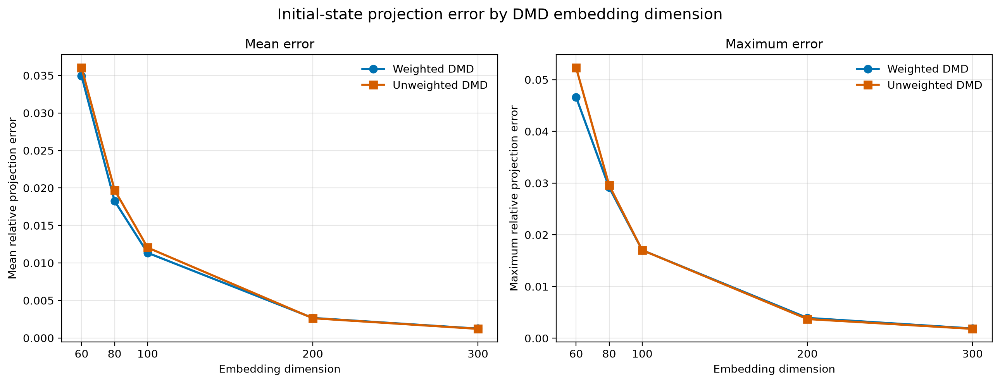

# 2D Heat Equation Integrator & Dynamic Mode Decomposition (DMD)

[](https://www.python.org/)
[](https://opensource.org/licenses/MIT)

Python exploratory project implementing a numerical solution for the 2D heat equation with spatially varying diffusivity $\alpha(x,y)$, paired with Dynamic Mode Decomposition (DMD) for data-driven spatio-temporal predictions.

---

## 📌 Overview

This repository includes:
1. **Variable-Diffusivity 2D Integration:** Numerical solution to $$\frac{\partial T}{\partial t} = \nabla \cdot \big(\alpha(x,y) \nabla T\big)$$ using finite difference schemes.
2. **Data-Driven Model Reduction (DMD):** Extraction of dynamic modes and spatial modes to construct a reduced order model from simulation snapshots.
3. **Generalization & Out-of-Sample Forecasting:** Reconstruction and prediction tests across initial conditions different from the training dataset.

---

## 📊 Key Results & Validation

The DMD predictions successfully generalize to unseen initial states, achieving $\le 10^{-3}$ relative $L^2$ errors on data sampled from the same distribution when enough modes are used.
The result, however is highly dependent on the number of initial conditions the model is shown, which should be at least $\sim 30$ for good predictions, as well as the embedding dimension.
The main error source in almost all simulations was caused by the projection of the initial state over the learned subspace. The reduced order dynamics barely seems to have any influence on the errors.
The plots below show the norm of the average difference (over many test simulations) between the initial state and its projection in the subspace as a function of the embedding dimension, both when initial states are over-weighted, and when weighting is uniform across state transitions. 


---

## ⚡ Quickstart

### Installation

```bash
git clone [https://github.com/NickkTr/Heat2D-DMD.git](https://github.com/NickkTr/Heat2D-DMD.git)
cd Heat2D-DMD
pip install -r requirements.txt
```

---

## 📁 Repository Structure

```text
├── assets/              # Static visuals used in the README
├── data/                # Generated numerical simulation files (.npy) and animations
├── results/             # Evaluation plots, error curves, and benchmark JSONs
├── heat_sim_engine.py   # 2D Finite Difference Solver
├── heat_initial_conditions.py # Initial condition generators and helper structures
├── dmd_engine.py        # Dynamic Mode Decomposition (training & prediction)
├── dmd_eval.py          # Evaluation script for unseen initial conditions
├── dmd_projection_evaluation.py # Initial state reconstruction benchmarks
├── errors_vs_trajectories.py    # Script to compute and plot error scaling
├── requirements.txt
└── README.md
```

---

## 🧮 Mathematical Formulation

The system models thermal diffusion in non-homogeneous media:

$$\frac{\partial u}{\partial t} = \alpha(x,y) \left( \frac{\partial^2 u}{\partial x^2} + \frac{\partial^2 u}{\partial y^2} \right) + \frac{\partial \alpha}{\partial x} \frac{\partial u}{\partial x} + \frac{\partial \alpha}{\partial y} \frac{\partial u}{\partial y}$$

DMD approximates the non-linear spatio-temporal trajectory via a linear operator $\mathbf{A} \approx \mathbf{X}' \mathbf{X}^\dagger$ via SVD rank truncation. By selecting a subset of the obtained singular values, one can build a reduced order model for future prediction and state/trajectory reconstruction.